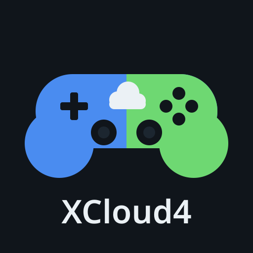

# XCloud4

  

**XCloud4** is an independent, native Xbox Cloud Gaming client for PlayStation 4 consoles running GoldHEN, built with the open-source OpenOrbis PS4 Toolchain.

> **Mission:** Helping more people play next-gen games without buying a new console.

---

## Requirements

- **Console:** PlayStation 4 running **GoldHEN** (tested on an original PS4 Fat with firmware **12.00** and **GoldHEN v2.4b18.7**).
- **Subscription:** An Xbox Game Pass plan that includes cloud gaming (PC Game Pass does not).
- **Network:** A stable internet connection of at least **15 Mbps**, preferably with the PS4 connected by wired Ethernet.

---

## Editions

Both editions are built from this exact source tree (`X4_PUBLIC=1` and `X4_PUBLIC=0`) and use separate PS4 Title IDs and icons so they can be installed side by side on the same console:

| Edition | Package | PS4 Menu Title | Title ID | Target Audience |
|---|---|---|---|---|
| **Public Beta** | `XCloud4-1.0.0-beta-publico.pkg` | `XCloud4` | `XCLD00003` | Everyday players: streamlined 720p60 streaming, Microsoft sign-in with an on-screen code, DualShock 4 rumble, and automatic Spanish/English UI. |
| **Experimental Lab** | `XCloud4-0.7.51-lab.pkg` | `XCloud4 Lab` | `XCLD00001` | Advanced testers: adds 720p and 1080p request profiles, the `R3` technical settings menu, and per-session `/data` diagnostic logs. |

See [RELEASE_NOTES_1.0.0-beta.md](RELEASE_NOTES_1.0.0-beta.md) and [RELEASE_NOTES_lab-0.7.51.md](RELEASE_NOTES_lab-0.7.51.md) for full details on each package.

---

## Installation

1. Download `XCloud4-1.0.0-beta-publico.pkg` (or `XCloud4-0.7.51-lab.pkg` for the experimental lab edition).
2. Copy the `.pkg` file to your PS4 using either:
   - A **USB drive** (FAT32 or exFAT) placed in the root directory, or
   - The **GoldHEN FTP server** into `/data/pkg/`.
3. On the PS4, open **GoldHEN > Debug Settings > Package Installer** and install the package.
4. Launch **XCloud4** from the PS4 home screen and sign in on your phone or PC at the address shown on screen (usually `microsoft.com/link`) using the on-screen code.

---

## Controls

### In-Game Shortcuts (while streaming)

| Shortcut | Action |
|---|---|
| Hold **L1 + R1** | Display the on-screen shortcut bar |
| **L1 + R1 + CIRCLE** | Disconnect the current cloud session and return to the catalog |
| **L1 + R1 + SQUARE** | Mute or unmute game audio |
| **L1 + R1 + TOUCHPAD** | Send the **Xbox Guide** button to the cloud console |
| **OPTIONS** | Mapped to the **Xbox Menu** button |
| **TOUCHPAD click** | Mapped to the **Xbox View** button |

### Exiting the Application

- To close **XCloud4** at any time: press the **PS button** and select **Close Application** (`PS button > Close Application`).
- *(In the Experimental Lab edition only, pressing `OPTIONS` in the main menu or catalog also initiates a clean exit.)*

---

## Automatic Language and Region

XCloud4 automatically detects your PS4 system language at startup via `sceSystemServiceParamGetInt(ORBIS_SYSTEM_SERVICE_PARAM_ID_LANG)`:

- **User interface language:** **Spanish** if the console is set to Spanish (Spain or Latin America); **English** for all other console language settings.
- **Catalog and cloud region:** Store metadata, cover art, and cloud session locale/market parameters automatically follow your console language (`es-ES`/`ES`, `es-MX`/`MX`, `en-US`/`US`, `en-GB`/`GB`, `pt-BR`/`BR`, `pt-PT`/`PT`, `fr-FR`/`FR`, `fr-CA`/`CA`, `de-DE`/`DE`, `it-IT`/`IT`, defaulting to `en-US`/`US`).

---

## Mission and Support

XCloud4 is built with a single goal: **helping more people play next-gen games without buying a new console**.

If this project is useful to you and you would like to support its independent development, voluntary donations are welcome on Ko-fi:

- **Ko-fi:** [https://ko-fi.com/asapedgr](https://ko-fi.com/asapedgr)

Voluntary donations support development only and **do not grant access to any games, accounts, or subscriptions**.

---

## Transparency Note on Microsoft Sign-In

To authenticate with Xbox Cloud Gaming, XCloud4 uses the standard Microsoft OAuth 2.0 device-code flow at the address shown on screen (usually `microsoft.com/link`). When the project tested its own application registration, the streaming authorization step (Passport) rejected it with `invalid_scope`; for that reason, XCloud4 uses the public client identifier (`1f907974-e22b-4810-a9de-d9647380c97e`) that is also used by other open-source Xbox Cloud Gaming clients (such as GreenVita).

- Public device-code clients use **no client secret**.
- Your Microsoft password is entered **only** on Microsoft's official verification page in your own browser, never inside XCloud4.
- Access and refresh tokens are held **only in PS4 RAM** while the application is running and are never written to disk or shared externally.

---

## Non-Affiliation Notice

XCloud4 is an independent, community-developed open-source project. It is **not affiliated with, authorized by, endorsed by, or in any way officially connected with Microsoft Corporation, Xbox, Sony Interactive Entertainment, or any of their subsidiaries or affiliates**. All product and company names are trademarks or registered trademarks of their respective holders.

---

## Building and License

- Build instructions for reproducing both packages from source are documented in [BUILDING.md](BUILDING.md).
- XCloud4 is free software distributed under the **GNU General Public License v3.0 only (`GPL-3.0-only`)**. See [LICENSE](LICENSE), [THIRD_PARTY_NOTICES.md](THIRD_PARTY_NOTICES.md), and [docs/licenses/](docs/licenses/) for complete license terms and third-party attributions.
